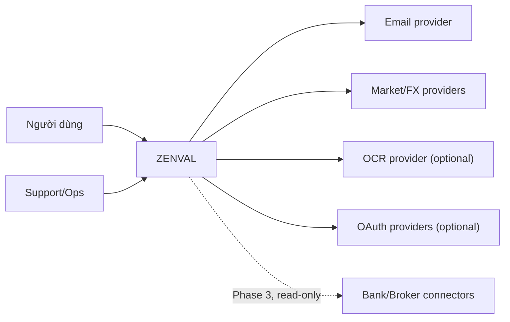
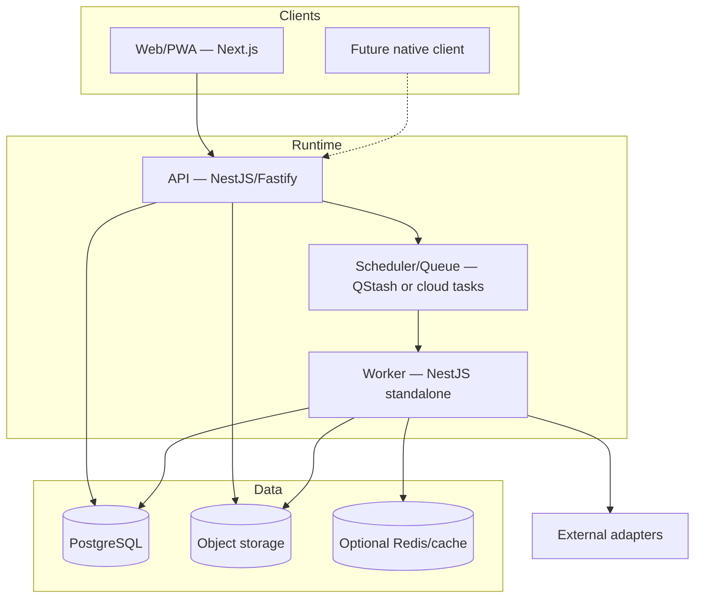
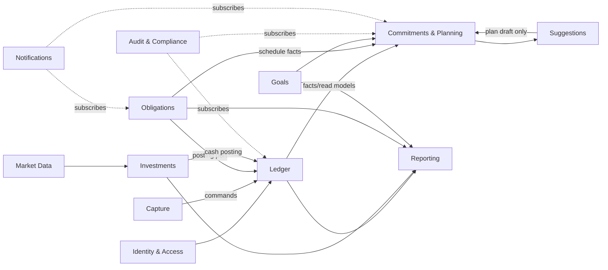
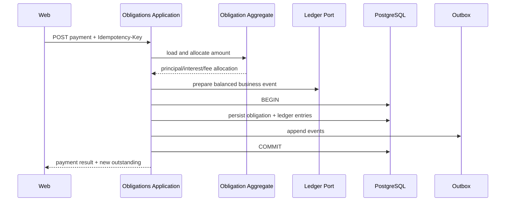
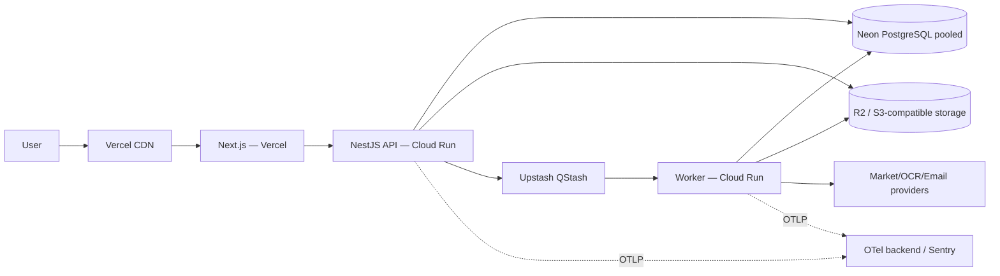
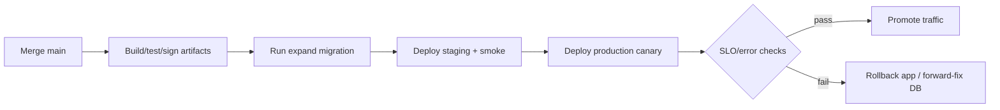

# Technical Architecture — ZENVAL

| Thuộc tính         | Giá trị                                                                                  |
| ------------------ | ---------------------------------------------------------------------------------------- |
| Trạng thái         | Proposed for engineering review                                                          |
| Phiên bản          | 1.0                                                                                      |
| Ngày               | 01/11/2026                                                                               |
| Product            | **ZENVAL**                                                                               |
| Brand meaning      | **Zen** + **Value**                                                                      |
| Tagline            | **Zenval — Calm numbers. Clear decisions.**                                              |
| Brand clearance    | Internal technical codename/product name; public domains pending legal clearance         |
| Nguồn yêu cầu      | [PRD web-app quản lý tài chính cá nhân](./PRD-web-app-quan-ly-tai-chinh-ca-nhan.md) v1.0 |
| Architecture style | DDD modular monolith + layered/hexagonal architecture                                    |
| Primary runtime    | Node.js Active LTS + TypeScript strict                                                   |
| Frontend           | Next.js App Router                                                                       |
| Backend            | NestJS + Fastify                                                                         |
| Primary database   | PostgreSQL                                                                               |
| Deployment đề xuất | Vercel (web) + Google Cloud Run (API/worker) + Neon (PostgreSQL)                         |

> Tài liệu này định nghĩa kiến trúc đích, technology stack và deployment topology. Đây chưa phải implementation plan cấp sprint hay authorization để build. Giá/free tier của dịch vụ cloud có thể thay đổi; phải kiểm tra lại trước mỗi launch gate.

## 1. Executive decision

Xây sản phẩm dưới dạng **modular monolith theo Domain-Driven Design**, dùng **layered/hexagonal architecture** bên trong từng bounded context. Web client và backend API deploy độc lập. Backend API và worker đều stateless, đóng gói container để có thể scale ngang. PostgreSQL là source of truth cho ledger và dữ liệu nghiệp vụ; các projection/cache có thể rebuild.

### 1.1 Product identity và technical naming

Tên sản phẩm chính thức là **ZENVAL**, ghép từ **Zen** và **Value**. Architecture phải hỗ trợ lời hứa _Calm numbers. Clear decisions._ bằng một source of truth rõ ràng, calculation lineage, provenance, timestamp và reconciliation. “Calm” là cách trình bày và vận hành đáng tin cậy, không phải làm mờ missing data, uncertainty hoặc financial risk.

Quy ước technical identifiers:

| Scope                        | Convention                                                                               |
| ---------------------------- | ---------------------------------------------------------------------------------------- |
| Git repository/root          | `zenval`                                                                                 |
| Package namespace            | `@zenval/*`                                                                              |
| Deployable services          | `zenval-web`, `zenval-api`, `zenval-worker`, `zenval-migration`                          |
| OpenTelemetry `service.name` | `zenval.web`, `zenval.api`, `zenval.worker`                                              |
| Database/application roles   | `zenval_api`, `zenval_worker`, `zenval_migrator`, `zenval_readonly`                      |
| Object-storage prefix        | `zenval/{environment}/{workspace_id}/...`                                                |
| Auth issuer/audience         | `zenval` / versioned API audience; final URI after domain clearance                      |
| Public domains               | Chỉ chốt sau trademark/domain clearance; không hard-code provider domain trong contracts |

Tên viết `ZENVAL` trong wordmark, release title và brand lockup; dùng `Zenval` trong UI copy, email và câu văn. Internal code identifiers dùng lowercase `zenval`.

> Naming status: ZENVAL đã được product owner chọn thay CLARIX và có mức collision software/finance thấp hơn trong public search sơ bộ. Tuy vậy, public domain, OAuth issuer URI, app-store listing và external package publication chỉ được khóa sau legal/domain clearance. Bounded-context/package structure không được phụ thuộc vào user-facing brand ngoài composition/config layer.

Topology đề xuất:

```text
Browser / PWA
     │
     ▼
Next.js on Vercel ───────► NestJS API on Cloud Run ───────► Neon PostgreSQL
                                  │                              │
                                  ├────► Object Storage          │
                                  ├────► QStash / Task trigger   │
                                  └────► Worker on Cloud Run ─────┘
```

Lý do không deploy toàn bộ backend NestJS và jobs vào một Vercel project:

- Vercel phù hợp nhất cho Next.js, CDN, preview deployment và các HTTP function ngắn.
- Import lớn, snapshot, market-price refresh, forecast rebuild, export/delete và job retry cần execution model riêng, không bị trói vào request lifecycle.
- API container trên Cloud Run vẫn scale-to-zero ở pilot, nhưng giữ đường nâng cấp rõ ràng cho horizontal autoscaling, long-running jobs và portability.
- Vercel Hobby chỉ dành cho personal/non-commercial use; public/commercial beta phải dùng plan phù hợp hoặc chuyển frontend sang Cloud Run/Cloudflare Pages. [Vercel mô tả Hobby là gói personal, non-commercial](https://vercel.com/docs/plans/hobby).

## 2. Architecture drivers từ PRD

### 2.1 Business drivers

1. Correct financial picture: transfer, debt principal, receivable principal và investment flows phải được phân loại đúng.
2. Explainability: mọi số tổng hợp phải truy về dữ liệu nguồn, version công thức và timestamp.
3. Manual-first nhưng integration-ready: không khóa kiến trúc vào một ngân hàng, broker hoặc market-data provider.
4. Web/PWA trước, native sau: domain contract phải độc lập UI framework.
5. Progressive modules: user có thể không dùng budgeting, debt hoặc investment.
6. Suggestions chỉ hỗ trợ quyết định; không tự thực hiện hành động tài chính.

### 2.2 Quality attributes

| Attribute              | Architecture response                                                                         |
| ---------------------- | --------------------------------------------------------------------------------------------- |
| Correctness            | PostgreSQL transaction, ledger invariants, decimal types, idempotency và golden tests         |
| Horizontal scalability | Stateless API/worker, external session/storage, queue-based async work, pooled DB connections |
| Auditability           | Append-only audit/outbox, calculation version và data lineage                                 |
| Security/privacy       | Tenant isolation, least privilege, encryption, redaction, export/delete workflow              |
| Reliability            | Idempotent commands/jobs, retry with backoff, DLQ, restore drill, last-known market data      |
| Evolvability           | DDD bounded contexts, ports/adapters, modular monolith, versioned APIs/events                 |
| Cost control           | Scale-to-zero pilot, managed free tiers, max-instance/budget alerts, no Kubernetes initially  |
| Portability            | OCI containers, standard PostgreSQL, S3-compatible object port, OpenTelemetry                 |

### 2.3 Constraints

- Node.js + TypeScript là stack ưu tiên.
- Single-user workspace ở Phase 1, nhưng mọi aggregate phải có `workspace_id`.
- Multi-currency-ready ngay từ schema đầu tiên.
- Không dùng floating point cho tiền.
- Không phụ thuộc distributed transaction giữa services ở Phase 1.
- Không đưa Kubernetes, Kafka, Elasticsearch hoặc microservices vào MVP nếu chưa có load/organization evidence.

## 3. Architecture principles

1. **Domain owns rules.** Next.js, NestJS controller và ORM không chứa accounting rules.
2. **Dependency points inward.** Domain không import framework, ORM, HTTP hoặc provider SDK.
3. **One write authority.** Chỉ backend application layer được ghi financial ledger.
4. **Transaction boundary follows aggregate/use case.** Một command hoặc commit atomic, không kéo transaction qua HTTP/provider.
5. **Async by default for slow work.** Import, export, OCR, market sync, forecast, notification chạy qua durable job.
6. **At-least-once + idempotency.** Không giả định queue exactly-once.
7. **Derived data is rebuildable.** Balances, holdings, forecast và report projections có thể tái tạo từ facts.
8. **No shared mutable process state.** Instance API/worker có thể bị thay hoặc scale bất kỳ lúc nào.
9. **Secure and private by default.** Raw financial fields không đi vào log/analytics/cache public.
10. **Measure before splitting.** Modular monolith trước; tách service chỉ khi có bounded context, load hoặc ownership reason rõ.

## 4. System context và containers

### 4.1 C4 — system context



### 4.2 C4 — container view



### 4.3 Deployable units

| Unit               | Trách nhiệm                                                              | Không chứa                            |
| ------------------ | ------------------------------------------------------------------------ | ------------------------------------- |
| `zenval-web`       | UI, PWA shell, accessibility, BFF-safe reads nếu cần, auth UX            | Accounting rules, direct DB access    |
| `zenval-api`       | AuthN/AuthZ, command/query API, transaction boundary, ledger writes      | Long batch processing, cron ownership |
| `zenval-worker`    | Durable jobs, imports, snapshots, projection rebuilds, external adapters | Public user-facing API                |
| `zenval-migration` | Schema migration one-shot, advisory lock                                 | Business traffic                      |
| `admin` (P2)       | Internal support tools qua separate authorization                        | Direct unrestricted database console  |

## 5. DDD strategic design

### 5.1 Bounded contexts

| Context                  | Trách nhiệm                                                           | Core aggregates                                | Phụ thuộc được phép                      |
| ------------------------ | --------------------------------------------------------------------- | ---------------------------------------------- | ---------------------------------------- |
| Identity & Access        | User, workspace, membership, session, consent                         | User, Workspace, Consent                       | Không phụ thuộc financial contexts       |
| Ledger                   | Accounts, business events, balanced entries, reconciliation           | Account, BusinessEvent, Reconciliation         | Identity; FX reference                   |
| Classification & Capture | Import, review inbox, category, merchant, recurring detection         | ImportJob, ReviewItem, CategorizationRule      | Ledger qua application port              |
| Commitments & Planning   | Fixed commitments, expected occurrences, spending plan, STS, forecast | FixedCommitment, Plan, ForecastRun             | Ledger facts; Obligations; Goals         |
| Obligations              | Payable, receivable, schedules, principal/interest/fee, simulation    | Obligation, Installment, Scenario              | Ledger posting port                      |
| Investments              | Portfolio, activity, holdings, cost basis, performance                | Portfolio, InstrumentActivity, CorporateAction | Ledger cash event; Market Data           |
| Goals                    | Targets, allocation links, projections                                | Goal                                           | Account/holding read models              |
| Market Data              | Instrument resolution, price/FX snapshots, provider health            | Instrument, PriceSnapshot, FXRate              | External providers only                  |
| Reporting                | Net worth, P&L, cash flow, period close, exports                      | PeriodClose, ReportRun                         | Read models from all contexts            |
| Suggestions              | Eligibility, evidence, confidence, guardrails, plan draft             | Suggestion, SuggestionEvidence                 | Read-only snapshots; Planning command    |
| Notifications            | Preferences, notification, delivery attempts                          | Notification                                   | Domain events from other contexts        |
| Audit & Compliance       | Immutable audit, export/delete orchestration, admin access            | AuditEvent, DataRequest                        | Receives events; explicit deletion ports |

### 5.2 Context map



### 5.3 Ownership rules

- Chỉ Ledger context được tạo/sửa posted `BusinessEvent` và `LedgerEntry`.
- Obligations sở hữu schedule/outstanding; nó yêu cầu Ledger post disbursement/payment qua port.
- Investments sở hữu quantity/cost basis; cash leg được link tới Ledger event, không duplicate cash balance.
- Planning không sửa transaction facts. `Apply to plan` chỉ tạo plan draft/version.
- Reporting và Suggestions không ghi vào source aggregates; chúng dùng snapshots/read models.
- Không context nào query trực tiếp table nội bộ của context khác trong domain code. Trong modular monolith, cross-context read đi qua application query port hoặc stable projection view.

## 6. Tactical DDD và layered architecture

### 6.1 Layers trong mỗi module

```text
┌─────────────────────────────────────────────┐
│ Interface / Presentation                   │
│ HTTP controllers, DTO, auth guards         │
├─────────────────────────────────────────────┤
│ Application                                │
│ Commands, queries, use cases, transactions │
├─────────────────────────────────────────────┤
│ Domain                                     │
│ Aggregates, entities, value objects, rules │
├─────────────────────────────────────────────┤
│ Infrastructure                             │
│ PostgreSQL, queue, provider adapters       │
└─────────────────────────────────────────────┘
```

Dependency direction:

```text
interface ──► application ──► domain
infrastructure ──implements──► application/domain ports
domain ──► nothing outside domain/shared kernel
```

### 6.2 Layer responsibilities

#### Domain

- Aggregate root, entity, immutable value object.
- Accounting invariants, state transition và domain service thuần TypeScript.
- Domain event mô tả fact đã xảy ra.
- Không decorator NestJS/Drizzle, không `Date.now()` trực tiếp; dùng `Clock` port khi cần deterministic test.

#### Application

- Một use case/handler cho mỗi command/query.
- Load aggregate qua repository port, gọi domain method, persist trong transaction.
- Authorization ở use-case level dựa trên `ActorContext`, không chỉ controller guard.
- Publish outbox event trong cùng DB transaction.
- Không trả ORM entity trực tiếp.

#### Interface

- REST controller, request validation, mapping DTO, pagination, error mapping.
- Authentication, rate-limit metadata, idempotency headers.
- Không quyết định transaction type hoặc tính toán số dư.

#### Infrastructure

- Drizzle repositories, SQL projections, provider adapters, object storage, queue publisher.
- Mapping persistence model ↔ domain model.
- Không leak provider DTO vào domain.

### 6.3 Building blocks

| Building block      | Ví dụ                                                                               |
| ------------------- | ----------------------------------------------------------------------------------- |
| Value object        | `Money`, `Currency`, `ExchangeRate`, `Percentage`, `LocalDate`, `Period`            |
| Aggregate           | `BusinessEvent`, `FixedCommitment`, `Obligation`, `Portfolio`, `Goal`               |
| Entity              | `LedgerEntry`, `ExpectedOccurrence`, `Installment`, `InvestmentActivity`            |
| Domain service      | `PostingPolicy`, `PaymentAllocator`, `SafeToSpendCalculator`, `CostBasisCalculator` |
| Repository port     | `BusinessEventRepository`, `ObligationRepository`                                   |
| Application service | `PostTransferHandler`, `MatchCommitmentHandler`, `RunForecastHandler`               |
| Domain event        | `BusinessEventPosted`, `CommitmentOccurrencePaid`, `PriceSnapshotReceived`          |
| Integration event   | Versioned event emitted via outbox after commit                                     |

### 6.4 Shared kernel

Shared kernel phải nhỏ và ổn định:

- IDs (`WorkspaceId`, `AccountId`, ULID/UUIDv7 strategy).
- `Money`/currency precision policy.
- `Clock`, `Result`, base domain error.
- `ActorContext`, correlation/causation IDs.
- Outbox/event envelope schema.

Không đưa generic repositories, framework wrappers hoặc mọi DTO vào shared kernel.

### 6.5 Example use case: trả khoản vay ngân hàng



Toàn bộ obligation update và ledger posting phải nằm trong một database transaction của modular monolith. Đây là lý do không tách Ledger và Obligations thành microservices ở Phase 1.

## 7. Data architecture

### 7.1 PostgreSQL as system of record

- Một PostgreSQL cluster, logical schemas theo context: `iam`, `ledger`, `capture`, `planning`, `obligation`, `investment`, `market`, `reporting`, `audit`.
- Migrations theo forward-only, review SQL diff, expand/contract cho zero/low downtime.
- Mọi business table có `id`, `workspace_id`, `created_at`, `updated_at`, `version`; facts immutable có `recorded_at`.
- Foreign key và check constraint cho invariants có thể biểu diễn ở DB.
- Row-level tenant predicate luôn nằm trong repository; xem xét PostgreSQL RLS như defense-in-depth sau benchmark.

### 7.2 Money, quantity và time

- Fiat amount: `numeric(20, 4)` hoặc integer minor-unit kết hợp currency metadata. Quyết định cuối phải nhất quán toàn hệ thống; đề xuất `numeric` trong DB + `Decimal` object trong Node vì FX/fee có sub-minor calculations.
- Không convert `numeric` sang JavaScript `number`; dùng `decimal.js` hoặc string boundary.
- Crypto/asset quantity: `numeric(38, 18)`; rate: precision riêng và validated bounds.
- Timestamp lưu `timestamptz` UTC; business due date dùng `date` + user timezone/policy.
- Original currency/amount bất biến; converted amount luôn link `fx_rate_id` và calculation version.

### 7.3 Ledger model

```text
business_event
  1 ─── N ledger_entry

ledger_entry:
  account_id
  side/debit_credit
  amount_original + currency
  amount_base + base_currency + fx_rate_id
  effective_at + posted_at
```

Invariants enforced ở domain + DB/procedural check nơi phù hợp:

- Posted event phải balanced theo base representation trong rounding tolerance.
- Event status transition hợp lệ; correction bằng reversal/new event, không sửa lịch sử âm thầm.
- Unique `(workspace_id, source_type, source_external_id)` khi source ID tồn tại.
- Unique idempotency result theo actor/scope/key.

### 7.4 CQRS nhẹ, không tách database

- Command path dùng aggregates và normalized write model.
- Query path dùng SQL views/materialized tables: account balances, commitment month status, holding snapshot, net-worth daily, report facts.
- Không dùng event sourcing toàn hệ thống. Ledger/business events là facts, nhưng user/profile/config aggregates giữ current state + audit.
- Projection cập nhật synchronous khi cần read-after-write critical; các report nặng cập nhật async và hiển thị `as_of`.

### 7.5 Outbox/inbox

- `outbox_event` được insert cùng transaction với aggregate change.
- Worker claim bằng `FOR UPDATE SKIP LOCKED`, publish/process và đánh dấu result.
- Consumer có `inbox_consumption` unique theo `event_id + handler_name`.
- Event envelope: `event_id`, `event_type`, `schema_version`, `occurred_at`, `workspace_id`, `aggregate_id`, `correlation_id`, `causation_id`, payload tối thiểu.
- Payload không chứa note/counterparty/raw amount nếu consumer không cần.

### 7.6 Backup và retention

- Managed PostgreSQL point-in-time recovery ở production plan; daily logical export encrypted cho disaster recovery nếu policy cho phép.
- Restore drill hàng quý, verify ledger checksum/golden reconciliation sau restore.
- Object storage lifecycle cho receipt/export; delete workflow có tombstone và provider deletion receipt.
- Audit retention tách khỏi raw sensitive data; privacy deletion pseudonymize/minimize theo legal policy.

## 8. API architecture

### 8.1 Protocol

- REST/JSON cho public product API; OpenAPI 3.1 generated và contract-tested.
- `/v1` path hoặc media-type versioning; breaking change qua version mới, additive change trong version hiện tại.
- Native/web dùng cùng application API; không expose database/provider contracts.
- GraphQL không cần ở Phase 1; có thể xem lại nếu client composition chứng minh REST gây overfetch nghiêm trọng.

### 8.2 API conventions

| Concern     | Standard                                                                              |
| ----------- | ------------------------------------------------------------------------------------- |
| IDs         | Opaque UUIDv7/ULID string                                                             |
| Money       | `{ amount: "1000000", currency: "VND" }`, không JSON number                           |
| Date/time   | ISO 8601; `date` riêng cho due date                                                   |
| Pagination  | Cursor, stable sort, bounded limit                                                    |
| Errors      | RFC 9457-style problem details + stable application code                              |
| Concurrency | `version`/ETag + `If-Match` cho mutable resources                                     |
| Idempotency | `Idempotency-Key` bắt buộc cho financial commands/import commit                       |
| Correlation | `X-Request-Id`, server-generated nếu thiếu                                            |
| Auth        | Secure httpOnly session cookie cho web; scoped bearer/access token cho native sau này |

### 8.3 Command/query separation

- Command endpoint trả resource/result tối thiểu sau commit.
- Query endpoint có filter whitelist và field-level authorization.
- Bulk import upload trực tiếp object storage bằng signed URL, không đi qua function body lớn. Vercel Functions có giới hạn payload request/response 4.5 MB, vì vậy upload phải direct-to-storage hoặc chunked. [Vercel Functions limits](https://vercel.com/docs/functions/limitations).
- Export tạo async job rồi cung cấp signed URL có TTL, không stream file lớn từ API request.

## 9. Async jobs và scheduling

### 9.1 Job classes

| Queue/job            | Trigger                    | Idempotency key                         | Retry policy                       |
| -------------------- | -------------------------- | --------------------------------------- | ---------------------------------- |
| Import parse/commit  | User upload                | import job + content hash               | Exponential; row-level errors      |
| Projection rebuild   | Domain/outbox event        | projection + event/version              | Retry; DLQ after threshold         |
| Forecast/suggestion  | Data changed/schedule      | workspace + input cutoff + calc version | Coalesce/debounce                  |
| Market price/FX      | Schedule/provider callback | instrument + observed date + provider   | Circuit breaker/jitter             |
| Notification         | Due domain event           | notification + channel                  | Bounded retry, respect quiet hours |
| Export/delete        | User request               | data request ID                         | Resumable steps, auditable         |
| Reconciliation check | Period close               | workspace + period                      | Deterministic rerun                |

### 9.2 Pilot queue

Đề xuất QStash cho pilot vì có schedule, retry và HTTP delivery; free plan hiện công bố 1.000 messages/ngày và 10 active schedules, nhưng không có production SLA. [QStash pricing](https://upstash.com/pricing/qstash) và [background jobs](https://upstash.com/docs/qstash/features/background-jobs).

Rules:

- QStash chỉ gửi `job_id`/signed envelope; payload tài chính nằm trong PostgreSQL.
- Endpoint worker verify signature, claim job bằng atomic state transition.
- Mỗi job có `queued/running/succeeded/failed/dead`, attempts, next retry và heartbeat.
- Job dài chia chunk/checkpoint; không giữ một HTTP request cho toàn bộ 10k rows.

### 9.3 Production evolution

- Khi vượt quota/SLA: chuyển queue port sang Google Cloud Tasks/Pub/Sub hoặc managed Redis/BullMQ.
- Không thay đổi application use cases; chỉ thay infrastructure adapter.
- Vercel Cron không là scheduler duy nhất cho nghĩa vụ tài chính vì Hobby cron không bảo đảm timing chính xác. [Vercel cron usage](https://vercel.com/docs/cron-jobs/usage-and-pricing).

## 10. Horizontal scalability

### 10.1 Stateless compute

- API session lưu ở database/auth store; không sticky session.
- File không lưu local disk; dùng object storage.
- Cache là optimization, không source of truth.
- Instance không giữ scheduler singleton hoặc in-memory job queue.
- Graceful shutdown: stop accepting requests, finish bounded work, release connections.

### 10.2 Scaling units

| Unit       | Scale signal                        | Guardrail                                  |
| ---------- | ----------------------------------- | ------------------------------------------ |
| Web        | Requests/CDN handled by Vercel      | Dynamic SSR only where needed              |
| API        | Concurrency, CPU, p95 latency       | Max instances protects DB connections/cost |
| Worker     | Queue depth, oldest job age         | Per-queue concurrency/rate limit provider  |
| PostgreSQL | CPU, IOPS, connection wait, storage | Pooled connections, indexes, query budgets |
| Projection | Lag and rebuild duration            | Partition/chunk by workspace/time          |

### 10.3 Database connections

- API dùng pooled PostgreSQL endpoint và connection budget per instance.
- Worker có pool riêng, concurrency bound.
- Cloud Run max instances × pool size phải nhỏ hơn DB safe connection budget.
- Neon hỗ trợ pooled endpoint/PgBouncer cho serverless; official guidance khuyên pooling khi nhiều connections. [Neon connection pooling guidance](https://neon.com/blog/performance-tips-for-neon-postgres).

Example initial budget:

```text
DB safe app connections: 80
API max instances: 10 × pool 4 = 40
Worker max instances: 5 × pool 4 = 20
Migration/admin/reserve: 20
```

Số trên là starting hypothesis, phải load test và chỉnh theo Neon plan/region.

### 10.4 Concurrency correctness

- Optimistic lock aggregate `version` cho user edits.
- `SELECT ... FOR UPDATE` hoặc serializable/retry cho account-sensitive posting.
- Unique constraint là tuyến phòng thủ cuối cho idempotency/duplicate.
- Advisory lock theo workspace/period cho monthly close hoặc projection rebuild, không dùng global lock.
- Deadlock/serialization failure retry bounded với jitter và same idempotency key.

### 10.5 Caching

- Public/static assets qua Vercel CDN.
- Private financial API mặc định `Cache-Control: no-store` hoặc private, không cache shared CDN.
- Cache safe reference data: category definitions, instrument metadata, provider-independent price reads có key theo version.
- User dashboard summary có thể cache encrypted/private keyed by workspace + input version; invalidation qua outbox.
- Không đưa raw notes, full account identifiers hoặc auth tokens vào Redis/CDN.

## 11. Technology stack

### 11.1 Runtime và repository

| Area            | Choice                                          | Rationale                                            |
| --------------- | ----------------------------------------------- | ---------------------------------------------------- |
| Runtime         | Node.js Active LTS, pinned bằng `.nvmrc`/Volta  | LTS security/support, common runtime toàn stack      |
| Language        | TypeScript `strict: true`, no implicit `any`    | Domain safety, shared contracts/tooling              |
| Package manager | `pnpm` workspaces + locked version              | Fast, disk efficient, strict dependency graph        |
| Monorepo        | Turborepo                                       | Task graph/cache đơn giản, phù hợp web/API/packages  |
| Formatting/lint | Biome; ESLint chỉ cho framework rules còn thiếu | Một fast tool cho format/base lint                   |
| Git hooks       | Lefthook hoặc simple package scripts            | Không để hooks thành source of truth; CI vẫn enforce |

Pin exact versions trong lockfile; Renovate/Dependabot mở PR theo nhóm và không auto-merge major/security-sensitive packages.

### 11.2 Frontend

| Concern      | Choice                                           | Notes                                                                          |
| ------------ | ------------------------------------------------ | ------------------------------------------------------------------------------ |
| Framework    | Next.js App Router                               | SSR/static/PWA, Vercel-native, future self-host path                           |
| UI           | React + TypeScript                               | Server Components cho shell/reference reads; client components cho interaction |
| Styling      | Tailwind CSS + CSS variables/design tokens       | Fast, theme-ready, accessible primitives                                       |
| Components   | Radix UI primitives hoặc React Aria              | Không dùng component có accessibility không rõ                                 |
| Forms        | React Hook Form + Zod                            | Validation UX; server vẫn validate độc lập                                     |
| Server state | TanStack Query cho interactive/private API state | Cache scoped, retry policy explicit                                            |
| Local state  | React state/Zustand chỉ khi cần                  | Không mirror server source of truth rộng                                       |
| Charts       | Recharts/Visx; table/text alternative bắt buộc   | Accessibility và responsive                                                    |
| PWA          | Web App Manifest + Serwist/Workbox               | Offline shell/draft; posted financial writes require sync confirmation         |
| i18n         | `next-intl`                                      | Vietnamese-first, future locales                                               |
| Testing      | Vitest, Testing Library, Playwright, axe         | Unit/component/E2E/accessibility                                               |

Frontend rules:

- Không import domain package có server-only secrets/behavior vào browser bundle. Chỉ share value schemas/contract types được audit.
- Không dùng Next.js Server Actions làm public domain contract chính; web gọi versioned API. Server Actions chỉ được dùng cho UI-local orchestration nếu không bypass API authorization/audit.
- Financial values truyền dạng string, format bằng locale ở presentation.
- Optimistic UI chỉ cho low-risk preference; financial command chờ server commit rồi render result.

### 11.3 Backend/API

| Concern       | Choice                                      | Notes                                                                                                                                         |
| ------------- | ------------------------------------------- | --------------------------------------------------------------------------------------------------------------------------------------------- |
| Framework     | NestJS                                      | Module/DI/guard/interceptor phù hợp modular architecture                                                                                      |
| HTTP adapter  | Fastify                                     | Performance và schema-first validation; Nest hỗ trợ adapter chính thức. [NestJS Fastify docs](https://docs.nestjs.com/techniques/performance) |
| Validation    | Zod qua adapter hoặc TypeBox/Fastify schema | Một schema cho runtime + OpenAPI; không tin client validation                                                                                 |
| API docs      | OpenAPI 3.1                                 | Generated, linted, breaking-change check                                                                                                      |
| Auth          | Better Auth behind `IdentityProvider` port  | TS-first, DB sessions, 2FA/passkey-capable; không để library model leak vào domain                                                            |
| Authorization | Application policies + Nest guards          | Workspace membership, resource ownership, step-up actions                                                                                     |
| ORM/query     | Drizzle ORM + `postgres`/node-postgres      | Typed SQL, explicit schema/transactions, low overhead                                                                                         |
| Decimal       | `decimal.js`                                | Không dùng JS number cho money/rate calculations                                                                                              |
| Logging       | Pino JSON + redaction                       | Fastify-friendly, correlation IDs                                                                                                             |
| Observability | OpenTelemetry Node SDK                      | Vendor-neutral traces/metrics; JS traces/metrics stable. [OpenTelemetry JS](https://opentelemetry.io/docs/languages/js/)                      |
| Email         | Resend adapter initially                    | Provider port để thay thế; không gửi raw sensitive amount mặc định                                                                            |

Better Auth hỗ trợ framework-agnostic TypeScript và các capability như session, 2FA/passkey; vẫn phải security review, test account recovery và đặt sau `IdentityProvider` port. [Better Auth introduction](https://better-auth.com/docs/introduction) và [2FA docs](https://better-auth.com/docs/plugins/2fa).

Drizzle có transaction/savepoint và isolation configuration, phù hợp repository adapter; domain không phụ thuộc Drizzle. [Drizzle transactions](https://orm.drizzle.team/docs/transactions).

### 11.4 Database và storage

| Concern          | Pilot choice                                              | Production-ready path                                     |
| ---------------- | --------------------------------------------------------- | --------------------------------------------------------- |
| PostgreSQL       | Neon Free/entry plan, pooled connection                   | Neon paid HA/PITR hoặc managed Postgres tương đương       |
| Object storage   | Cloudflare R2/S3-compatible or Vercel Blob for low volume | S3/R2 with lifecycle, malware scan, regional/legal review |
| Queue/schedule   | Upstash QStash                                            | Cloud Tasks/Pub/Sub or managed Redis queue                |
| Cache/rate-limit | Không bắt buộc; Upstash Redis khi cần                     | Regional managed Redis                                    |
| Search           | PostgreSQL trigram/full-text                              | Dedicated search chỉ khi evidence                         |
| Secrets          | Vercel/Cloud Run environment secrets ở pilot              | GCP Secret Manager + rotation                             |

### 11.5 Dev/test tooling

- Docker Compose: PostgreSQL, mail catcher, local object emulator optional, QStash dev server/mock.
- Testcontainers cho integration tests against real PostgreSQL.
- `tsx` cho scripts; không để production migrations phụ thuộc developer laptop.
- Pact/schemathesis optional P2; OpenAPI diff là required từ P1.
- k6 cho load; OWASP ZAP baseline; Trivy image scan; CodeQL/Semgrep; secret scanning.
- `eslint-plugin-boundaries` hoặc dependency-cruiser enforce layer/context imports.

## 12. Monorepo và code organization

### 12.1 Proposed structure

```text
zenval/
├─ apps/
│  ├─ web/                    # Next.js
│  ├─ api/                    # NestJS HTTP bootstrap
│  ├─ worker/                 # NestJS standalone/job HTTP bootstrap
│  └─ admin/                  # P2 internal tool
├─ packages/
│  ├─ contexts/
│  │  ├─ ledger/
│  │  │  ├─ domain/
│  │  │  ├─ application/
│  │  │  ├─ infrastructure/
│  │  │  └─ interface/
│  │  ├─ planning/
│  │  ├─ obligations/
│  │  ├─ investments/
│  │  └─ ...
│  ├─ contracts/              # OpenAPI-derived/shared safe schemas
│  ├─ shared-kernel/          # Money, IDs, clock, event envelope
│  ├─ database/               # schema composition/migration runner
│  ├─ observability/
│  ├─ config/
│  └─ ui/
├─ migrations/
├─ architecture/
│  ├─ adr/
│  └─ diagrams/
├─ tests/
│  ├─ e2e/
│  ├─ golden/
│  └─ load/
├─ turbo.json
├─ pnpm-workspace.yaml
└─ package.json
```

### 12.2 Dependency rules

```text
apps/* -> contexts/*/interface + composition roots
interface -> application
application -> domain + ports
infrastructure -> domain/application ports
domain -> shared-kernel only
contexts/A/domain -X-> contexts/B/infrastructure
web -> contracts + ui; never -> contexts/*/infrastructure
```

CI chạy dependency graph check. Vi phạm import là build failure.

### 12.3 Composition roots

- `apps/api`: wire repositories, application handlers, HTTP controllers.
- `apps/worker`: wire job handlers, provider adapters, no public user controller.
- Test composition dùng in-memory fake cho domain unit tests và real Postgres cho integration.
- Framework decorators chỉ ở interface/infrastructure composition, không ở domain classes.

## 13. Deployment architecture

### 13.1 Recommended pilot topology



### 13.2 Why this split

#### Vercel for web

- Excellent Next.js integration, CDN, TLS, Git preview deployments.
- Hobby useful for personal prototype, but not acceptable as free commercial production because official terms scope Hobby to non-commercial personal use.
- Deploy only web/SSR and thin proxy if needed; no financial jobs or large uploads.

#### Cloud Run for API and worker

- Runs standard OCI/Node container, automatically scales stateless services, including scale-to-zero; separate services/jobs/worker patterns are available. [Cloud Run overview](https://docs.cloud.google.com/run/docs/overview/what-is-cloud-run).
- Official pricing currently includes an always-free allowance; actual bill depends on region, egress and configuration. [Cloud Run pricing](https://cloud.google.com/run/pricing).
- Set max instances to protect cost and database. Cloud Run documents min/max instance controls and autoscaling. [Cloud Run configuration](https://docs.cloud.google.com/run/docs/configuring).

#### Neon for PostgreSQL

- Standard PostgreSQL and pooled endpoint make serverless/container compute practical.
- Free tier only for prototype/private beta; production requires PITR, support, capacity and compliance review.
- API/worker/database should use compatible region, preferably Singapore/near Vietnam subject to provider availability and legal review.

### 13.3 Environments

| Environment    | Web                                     | API/worker                                     | DB                           | Data policy                        |
| -------------- | --------------------------------------- | ---------------------------------------------- | ---------------------------- | ---------------------------------- |
| Local          | Next dev                                | Local Node/Docker                              | Local Postgres               | Synthetic only                     |
| Preview per PR | Vercel preview                          | Optional shared dev API or ephemeral Cloud Run | Neon branch/isolated schema  | Seed synthetic, no production copy |
| Staging        | Vercel project                          | Cloud Run staging                              | Separate Neon project/branch | Masked/synthetic                   |
| Production     | Vercel Pro or alternate commercial host | Cloud Run production                           | Paid managed Postgres        | Real data, strict access           |

Không dùng cùng database credentials giữa preview/staging/production.

### 13.4 Region strategy

- Phase 1 single primary region close to users and database, preferably Singapore if all critical providers support it.
- Web CDN global; API primary region. Không multi-region writes trong Phase 1.
- Object storage region/legal residency phải được approved.
- Disaster recovery cross-region via backup/restore trước; active-active chỉ khi RTO/RPO/business evidence đòi hỏi.

### 13.5 Network and ingress

- `app.example.com` → Vercel; `api.example.com` → Cloud Run HTTPS.
- Strict CORS allowlist; CSRF protection cho cookie-auth commands; SameSite/secure/httpOnly cookies.
- Worker endpoint không public-anonymous theo nghĩa nghiệp vụ: verify QStash signature/service identity, rate limit và job claim.
- Database không public allow-all nếu provider private networking khả dụng ở plan production; TLS bắt buộc.
- Object uploads qua signed URL với content-type/size/checksum restrictions và malware scan pipeline.

### 13.6 Deployment artifacts

- Web: immutable Vercel deployment, source maps private.
- API/worker: multi-stage Docker image, non-root user, read-only filesystem khi khả thi, health endpoints.
- Image tagged git SHA + semantic release; SBOM generated; signature/provenance in production.
- Cùng image version có thể chạy API/worker bằng different entrypoint, hoặc separate optimized images nếu bundle size/cold start chứng minh cần.

### 13.7 Health checks

| Endpoint          | Meaning                                                   |
| ----------------- | --------------------------------------------------------- |
| `/health/live`    | Process event loop responsive; không gọi dependency       |
| `/health/ready`   | Config valid, DB query lightweight, migrations compatible |
| `/health/version` | Build SHA, schema compatibility; không lộ secret          |

Provider outage không làm readiness false nếu core ledger vẫn dùng được; provider health là degraded metric riêng.

## 14. CI/CD và database delivery

### 14.1 Pull request pipeline

1. Install locked dependencies.
2. Secret/license/dependency scan.
3. Format/lint/typecheck và architecture dependency rules.
4. Unit/domain property tests.
5. PostgreSQL integration + migration up/down-safety checks.
6. Golden accounting/calculation tests.
7. Build web/API/worker and container scan.
8. Playwright critical journeys + axe on preview/staging.
9. OpenAPI breaking-change check.
10. Preview deployment with synthetic data.

Use GitHub Actions initially; cache pnpm/Turborepo. Protect main, require reviews for `ledger`, `obligation`, `investment`, migrations và auth.

### 14.2 Release pipeline



### 14.3 Migration rules

- Forward-only production migration; down migration chỉ dùng local/test nếu safe.
- Expand → deploy compatible code → backfill async → verify → contract in later release.
- Migration runner giữ PostgreSQL advisory lock; chỉ một runner.
- Không add non-null/default rewrite trên table lớn trong một blocking step.
- Backfill checkpointed, rate-limited, observable.
- Application startup không tự chạy migrations.

### 14.4 Rollback

- App revision rollback tự động/manual khi error/SLO vượt threshold.
- DB rollback bằng compatible schema/forward fix, không drop column cùng release.
- Calculation version có feature flag/kill switch; có thể recompute projections bằng version trước.
- External integration adapter có per-provider circuit breaker/disable flag.

## 15. Security architecture

### 15.1 Authentication

- Email/password hoặc magic-link/social tùy product decision; password hash do auth library chuẩn quản lý.
- MFA/TOTP optional P1, step-up bắt buộc cho export/delete, email/password/MFA change và integration connect ở production.
- Session token opaque/httpOnly, short idle + bounded absolute lifetime, revoke per device.
- Recovery flow có cooldown/notification và không bypass MFA tùy tiện.
- Native app sau này dùng Authorization Code + PKCE/OIDC-compatible token flow qua identity port.

### 15.2 Authorization

- `ActorContext = user_id, workspace_id, membership, auth_strength, session_id`.
- Mọi command/query bắt buộc workspace predicate và resource ownership.
- Deny by default; policy test matrix cho user/support/admin/service actor.
- Admin support access time-bound, reason/ticket required, audited; sensitive fields redacted.
- Không dùng UI visibility làm access control.

### 15.3 Data protection

- TLS in transit; provider-managed encryption at rest.
- Field-level envelope encryption cho đặc biệt nhạy cảm nếu threat model yêu cầu: account identifiers, provider tokens, documents.
- KMS/Secret Manager production; key rotation/version; không log decrypted values.
- Signed URL TTL ngắn, single-purpose; attachments private.
- Analytics không nhận raw amount, note, account number hoặc counterparty.

### 15.4 Application security controls

- Zod/schema validation và payload/field count limits.
- SQL parameterization only; no user-controlled identifiers/order without allowlist.
- CSRF, CORS allowlist, CSP, HSTS, secure cookies, clickjacking protection.
- Rate limits by IP + account + command sensitivity; brute-force lockout and anomaly alert.
- SSRF allowlist/provider adapters; file type sniff/size/hash/malware scan.
- Dependency/SBOM/container scanning; penetration test trước public launch.

### 15.5 Threat-specific decisions

| Threat                      | Control                                                             |
| --------------------------- | ------------------------------------------------------------------- |
| Cross-tenant IDOR           | Workspace predicate in repository, policy tests, optional RLS       |
| Duplicate financial command | Idempotency key + unique constraint + stored response               |
| Ledger tampering            | Append/reversal model, audit hash/checksum, restricted DB roles     |
| Stolen session              | Secure cookies, device revocation, step-up auth, anomaly signals    |
| Sensitive log leak          | Structured logging allowlist/redaction; no request-body logging     |
| Queue forgery/replay        | Provider signature, timestamp window, job atomic claim, idempotency |
| Supply chain                | Lockfile, provenance, scan, protected releases                      |

## 16. Observability and operations

### 16.1 Signals

- **Logs:** Pino structured JSON, event/error code, request/correlation ID, workspace hashed token, no raw finance content.
- **Traces:** OpenTelemetry across web server/API/worker/provider call; sampling higher for errors/financial writes.
- **Metrics:** request rate/error/duration, DB pool wait, job depth/age/retry, outbox lag, projection lag, provider health, calculation failures.
- **Audit:** separate immutable business/security trail, không thay bằng application logs.

### 16.2 SLOs

| Service indicator             |                     Initial target |
| ----------------------------- | ---------------------------------: |
| Core API availability         |                      99.9% monthly |
| API read p95                  |                            <500 ms |
| API command p95               |    <800 ms excluding external/bulk |
| Financial write correctness   | 0 known unbalanced committed event |
| Outbox projection p95 lag     |                  <60 s normal load |
| Critical notification job age |         <5 min, subject to channel |
| RPO/RTO                       |   ≤15 min / ≤4 h production target |

Free-tier pilot không thể hứa production SLO; target chỉ áp dụng sau khi dùng plans/providers có SLA và on-call readiness.

### 16.3 Alerts

- Page: unbalanced ledger attempt spike, auth abuse, DB unavailable, write error rate, deletion/export security failure.
- Ticket: provider stale, projection lag, import failure rate, queue DLQ, cost budget threshold.
- Dashboard: version, deploy marker, region, provider, top stable error codes.
- Runbook link trong alert; no alert without owner/action.

### 16.4 Operational controls

- Feature flags server-side for suggestion class, provider, OCR, connector.
- Kill switch for calculation version and market adapter.
- Read-only/degraded mode if writes unsafe; ledger core remains available when market provider fails.
- Reconciliation tools compare ledger/projections/checksums.

## 17. Testing strategy

### 17.1 Test pyramid

| Level                  | Scope                             | Required examples                                                 |
| ---------------------- | --------------------------------- | ----------------------------------------------------------------- |
| Domain unit            | Pure rules/value objects          | Transfer, Money/FX, debt allocation, STS, cost basis              |
| Property-based         | Invariants across generated cases | Entries balance, principal never in P&L, rounding bounded         |
| Repository integration | Real PostgreSQL                   | Transactions, locks, constraints, tenant filters                  |
| Contract               | OpenAPI/provider adapters         | Backward compatibility, provider fixture mapping                  |
| E2E                    | Critical user journeys            | Onboarding, capture, fixed commitment, debt, close, export/delete |
| Golden regression      | Known financial scenarios         | 60 PRD edge cases + production incident cases                     |
| Load/resilience        | k6/fault injection                | Horizontal scale, DB connection budget, provider outage           |
| Security/accessibility | ZAP/policy matrix/axe             | IDOR, CSRF, session, keyboard/screen reader                       |

### 17.2 Financial correctness gates

- No release if any ledger invariant/golden case fails.
- Calculation output snapshot includes calculation version, input cutoff and rounding policy.
- Differential test projections rebuilt from scratch vs incrementally updated.
- Mutation tests for critical posting/payment allocation rules considered after MVP baseline.
- Synthetic production canary workspace continuously runs reconciliation cases.

## 18. Performance and capacity plan

### 18.1 Initial load profile

Use PRD profile for load test:

- Normal user: 5 years, 10k transactions, 20 accounts, 20 commitments, 5 obligations, 200 investment activities.
- Heavy user: 100k business events, 100 accounts, 1k instruments/activities/import chunks.
- Pilot: 1k registered/100 concurrent; growth checkpoints at 10k, 100k, 1M users.

### 18.2 Query rules

- Every list bounded/paginated; no unbounded workspace export in request path.
- Index starts with `workspace_id` for tenant-scoped hot queries, followed by filter/sort.
- Explain-analyze captured for top queries; query timeout per API/job class.
- Reports read projections, not join entire raw ledger per dashboard request.
- Partition only after measurement; likely candidates are ledger/audit/price snapshots by time, not premature P1 requirement.

### 18.3 Scaling checkpoints

| Trigger                               | Action                                                                   |
| ------------------------------------- | ------------------------------------------------------------------------ |
| DB connection wait >10% request time  | Reduce pools, cap instances, optimize queries, upgrade DB                |
| Projection lag >5 min sustained       | Separate worker pool/queue, batch/chunk, add replicas if available       |
| Single context dominates CPU/releases | Extract deployable service only after contract/ownership review          |
| Reporting impacts writes              | Read replica/warehouse projection; keep source DB authoritative          |
| Global latency demand                 | Regional reads/CDN; no multi-primary writes without consistency redesign |

## 19. Cost-conscious deployment plan

### 19.1 Prototype/private alpha — near zero cost

| Component      | Service                                     | Cost posture                         | Limitation                                            |
| -------------- | ------------------------------------------- | ------------------------------------ | ----------------------------------------------------- |
| Web            | Vercel Hobby                                | Free within allowance                | Personal/non-commercial only; limited logs/support    |
| API/worker     | Cloud Run scale-to-zero                     | Free allowance may cover low traffic | Billing account, egress/cold start; no cost guarantee |
| PostgreSQL     | Neon Free                                   | Free allowance                       | No production SLA/retention assumptions               |
| Queue          | QStash Free                                 | 1k messages/day currently            | No prod SLA; quota/schedules                          |
| Object         | R2/free allowance or equivalent             | Low/free usage                       | Egress/operation/legal limits                         |
| CI             | GitHub Actions allowance                    | Low/free public/small repo           | Minutes/storage limits                                |
| Error tracking | Sentry free tier or OTel-compatible backend | Low/free                             | Retention/event caps                                  |

### 19.2 Public/commercial beta

- Upgrade Vercel to commercial-appropriate plan or self-host Next.js on Cloud Run.
- Paid database with backups/PITR/support and capacity; no user financial data on pause-prone free DB.
- Queue/provider with required retry retention/SLA.
- Budget alerts at 50/75/90/100%, hard max instances, egress monitor.
- Start with one region and no always-on minimum instances unless p95/cold-start evidence requires.

### 19.3 Production cost drivers

1. Database compute/storage/PITR and connection pooling.
2. Serverless CPU/memory and cross-region egress.
3. Market-data licensing, often larger than hosting cost.
4. OCR/receipt volume and object storage retention.
5. Logs/traces cardinality/retention.
6. Email/push volume and connector fees.

Do not optimize by weakening backup, audit, encryption, deletion or accounting correctness.

## 20. Architecture Decision Records

| ADR     | Decision                                                 | Status                            | Consequence                                                         |
| ------- | -------------------------------------------------------- | --------------------------------- | ------------------------------------------------------------------- |
| ADR-001 | DDD modular monolith, not microservices                  | Proposed                          | Strong transactions/easier ops; enforce boundaries in code          |
| ADR-002 | Layered/hexagonal per bounded context                    | Proposed                          | Domain testable/portable; extra mapping/boilerplate                 |
| ADR-003 | PostgreSQL system of record                              | Proposed                          | ACID/constraints/reporting; manage connection/scale carefully       |
| ADR-004 | Ledger facts + CQRS projections, not full event sourcing | Proposed                          | Rebuildable financial views without event-sourcing complexity       |
| ADR-005 | Next.js on Vercel; NestJS on Cloud Run                   | Proposed                          | Best-fit deployment; two platforms to operate                       |
| ADR-006 | NestJS + Fastify                                         | Proposed                          | Structured modules/performance; Fastify-compatible ecosystem needed |
| ADR-007 | Drizzle isolated behind repository ports                 | Proposed                          | Explicit typed SQL; team owns mapping/migrations discipline         |
| ADR-008 | REST/OpenAPI public contract                             | Proposed                          | Simple native/web contract; more endpoints than GraphQL             |
| ADR-009 | Outbox/inbox and at-least-once jobs                      | Proposed                          | Reliable events; requires idempotent consumers and cleanup          |
| ADR-010 | QStash pilot, replaceable queue port                     | Proposed                          | Fast/cheap start; no hard dependency for production                 |
| ADR-011 | Better Auth behind identity port                         | Proposed, security spike required | TS-first and feature rich; must test framework integration/recovery |
| ADR-012 | No Redis/Kafka/Kubernetes in P1                          | Proposed                          | Lower cost/ops; add only with measured need                         |
| ADR-013 | Single write region P1                                   | Proposed                          | Stronger consistency/simpler ops; regional DR not active-active     |

Mỗi ADR phải có file riêng trước implementation, gồm context, alternatives, decision, consequences, rollback trigger và owner/date.

## 21. Evolution path

### Phase A — Architecture runway

- Monorepo, CI, dependency boundary enforcement.
- Identity spike, Money/Decimal/FX spike, PostgreSQL migration strategy.
- Ledger vertical slice với outbox, audit, idempotency và golden tests.
- Deploy web/API/worker skeleton vào staging.
- Load test DB pooling/cold start; threat model và data map.

### Phase B — MVP modular monolith

- Accounts/transactions/import/review/fixed commitments/planning.
- Obligations and investments dùng posting ports.
- Reporting projections, async export/delete, provider adapters.
- SLO dashboards/runbooks/backups/restore drill.

### Phase C — Adaptive planning

- Suggestion engine as separate module/worker queue, vẫn cùng DB transaction boundary cho plan draft.
- Corporate actions, OCR, monthly close, richer projection workloads.
- Separate worker pools by queue class if needed.

### Phase D — Connected/native

- Native client dùng same API + OIDC/PKCE path.
- Banking/broker adapters isolated in integration context.
- Extract market ingestion/reporting services only if load/ownership warrants.
- Read replicas/warehouse for analytics; never expose warehouse as source of financial truth.

### Service extraction criteria

Chỉ tách một module thành microservice khi ít nhất hai điều kiện đúng:

1. Independent scaling profile material.
2. Separate team ownership/release cadence.
3. Failure isolation has measurable business value.
4. Data boundary and integration events stable.
5. Distributed consistency compromise được chấp nhận/documented.

Ledger–Obligations posting không phải ứng viên tách sớm vì cần transaction consistency mạnh.

## 22. Open technical questions

| ID       | Question                                                                                        | Decision deadline             |
| -------- | ----------------------------------------------------------------------------------------------- | ----------------------------- |
| TA-OQ-01 | `numeric + Decimal` hay integer minor unit + explicit residual cho mọi money path?              | Trước schema v1               |
| TA-OQ-02 | Better Auth deployment trong NestJS hay dedicated auth routes/BFF; session cookie domain model? | Auth spike                    |
| TA-OQ-03 | Neon/R2/GCP region và DPA có đáp ứng legal/data residency VN?                                   | Trước private beta data       |
| TA-OQ-04 | QStash hay Cloud Tasks ngay từ đầu dựa trên billing/ops readiness?                              | Trước async production        |
| TA-OQ-05 | PostgreSQL RLS P1 hay application predicates + integration policy tests?                        | Security design review        |
| TA-OQ-06 | Object storage provider nào hỗ trợ malware scan/lifecycle/deletion evidence tốt nhất?           | Receipt/export implementation |
| TA-OQ-07 | Cost basis/calculation library tự viết với golden tests hay audited finance library?            | Investment implementation     |
| TA-OQ-08 | PWA offline chỉ draft hay cho queued commands; conflict model thế nào?                          | Offline P2                    |
| TA-OQ-09 | Production frontend giữ Vercel hay consolidate Cloud Run để giảm vendor/egress?                 | Commercial beta               |

## 23. Engineering readiness checklist

### Before implementation

- [ ] Bounded context owners và ubiquitous language reviewed với Product.
- [ ] ADR-001 đến ADR-011 accepted hoặc revised.
- [ ] Ledger, Money/FX, debt payment và investment posting golden cases approved.
- [ ] Threat model, privacy data map và vendor DPA review hoàn tất.
- [ ] Prototype load test xác nhận DB connection budget và cold-start acceptable.
- [ ] Region, backup/PITR, RPO/RTO và delete-retention path được chốt.

### Before public beta

- [ ] Không dùng non-commercial free plan trái điều khoản.
- [ ] Paid production database/backup/restore drill và queue SLA decision.
- [ ] Pentest critical/high closed; cross-tenant/IDOR matrix pass.
- [ ] Observability, on-call, runbooks và cost budgets active.
- [ ] Export/delete, incident response và provider outage drills pass.
- [ ] Accounting invariants/golden suite are release-blocking.

## 24. Recommendation summary

### Chốt ngay

- DDD modular monolith + layered/hexagonal architecture.
- Next.js frontend, NestJS/Fastify backend, PostgreSQL, TypeScript strict.
- Stateless API/worker, outbox/inbox, idempotency, CQRS projections.
- Vercel cho web; Cloud Run cho API/worker; Neon pilot database.
- No Kubernetes, Kafka, microservices or full event sourcing in Phase 1.

### Phải spike trước build

- Money precision và ledger transaction model.
- Better Auth integration/recovery/MFA.
- Neon region/pooling/PITR/legal fit.
- QStash vs Cloud Tasks và job replay/security.
- Direct-to-object-storage upload/security scan.

### Không được dùng free tier như production guarantee

Free tier giúp prototype/private alpha rẻ, nhưng không thay thế SLA, backups, support, legal terms và capacity. Vercel Hobby hiện giới hạn vào personal/non-commercial use; production architecture phải có commercial plan hoặc host thay thế. Cloud Run/Neon/QStash free allowances cũng phải được xem là bootstrap, không phải contractual SLO.

---

## References — official documentation

- [Vercel Hobby Plan](https://vercel.com/docs/plans/hobby)
- [Vercel Functions limits](https://vercel.com/docs/functions/limitations)
- [Vercel platform limits](https://vercel.com/docs/limits)
- [Next.js self-hosting and multi-instance considerations](https://nextjs.org/docs/app/guides/self-hosting)
- [NestJS Fastify adapter](https://docs.nestjs.com/techniques/performance)
- [Cloud Run overview](https://docs.cloud.google.com/run/docs/overview/what-is-cloud-run)
- [Cloud Run autoscaling/configuration](https://docs.cloud.google.com/run/docs/configuring)
- [Cloud Run pricing](https://cloud.google.com/run/pricing)
- [Neon PostgreSQL performance/pooling guidance](https://neon.com/blog/performance-tips-for-neon-postgres)
- [Upstash QStash background jobs](https://upstash.com/docs/qstash/features/background-jobs)
- [Upstash QStash pricing](https://upstash.com/pricing/qstash)
- [Drizzle transactions](https://orm.drizzle.team/docs/transactions)
- [Better Auth overview](https://better-auth.com/docs/introduction)
- [Better Auth 2FA](https://better-auth.com/docs/plugins/2fa)
- [OpenTelemetry JavaScript](https://opentelemetry.io/docs/languages/js/)
